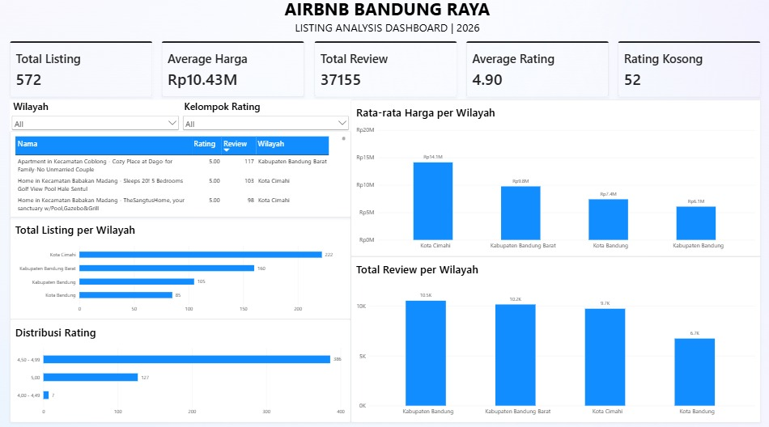

# Airbnb Bandung Raya Data Cleaning & EDA

## Project Overview

This project focuses on exploring and analyzing Airbnb listings across the Bandung Raya area. The analysis aims to understand listing distribution, pricing, ratings, and customer reviews across four regions.

This project follows a data analytics workflow, starting with data exploration and cleaning using Microsoft Excel, followed by exploratory SQL analysis using PostgreSQL, and data visualization using Microsoft Power BI.

The goal is to transform raw Airbnb listing data into meaningful insights that can help understand listing characteristics and differences across regions in Bandung Raya.

## Project Objectives

- Explore and understand Airbnb listing data in Bandung Raya.
- Identify and handle duplicate records and missing values.
- Standardize data formats and prepare the dataset for analysis.
- Analyze listing prices, ratings, and customer reviews.
- Compare listing distribution and average prices across regions.
- Present analytical findings through an interactive Power BI dashboard.

## Tools & Technologies

| Tool | Purpose |
|---|---|
| Microsoft Excel | Data exploration, data cleaning, data preparation, and cleaning documentation |
| PostgreSQL | Database management and SQL-based exploratory analysis |
| Microsoft Power BI | Data visualization, KPI creation, and interactive dashboard |
| GitHub | Project documentation and portfolio publication |

## Dataset

This project uses the **Indonesia Airbnb Dataset – Bandung Listings** from Kaggle.

- **Source:** [Indonesia Airbnb Dataset – Bandung Listings](https://www.kaggle.com/datasets/pandaa12/indonesia-airbnb-dataset-bandung-listings)
- **Format:** CSV
- **Original Files:** 5 CSV files
- **Regional Coverage:** Kota Bandung, Kabupaten Bandung, Kabupaten Bandung Barat, and Kota Cimahi.
- **Final Dataset:** 572 listings.
- **Main Attributes:** Listing ID, name, price, rating, number of reviews, listing URL, and region.

The four regional datasets were combined into one dataset for the main analysis. The Bandung Raya dataset was retained as a separate reference dataset.

## Project Workflow

### 1. Data Exploration & Cleaning – Microsoft Excel

Microsoft Excel was used to inspect, combine, and clean the original datasets.

The workbook contains the following sheets:

- `RAW_AirBnB_Kota_Cimahi`
- `RAW_AirBnB_Kota_Bandung`
- `RAW_AirBnb_Kab_Bandung_Barat`
- `RAW_AirBnb_Kab_Bandung`
- `RAW_AirBnB_BandungRaya_All`
- `Master_Combined`
- `Cleaning_Log`
- `Airbnb_Cleaned`

Main cleaning activities:

- Combining four regional datasets into `Master_Combined`.
- Checking and removing duplicate listings based on listing URLs.
- Removing 217 duplicate records.
- Handling 15 missing rating values and 37 `New` rating values by converting them into NULL.
- Standardizing column headers.
- Preparing price, rating, and review columns for analysis.
- Creating a `Listing_ID` column based on the Airbnb listing URL.
- Recording cleaning activities in `Cleaning_Log`.

After cleaning, the final dataset contains **572 listings and 7 columns**.

### 2. SQL Analysis – PostgreSQL

PostgreSQL was used to perform exploratory and business-oriented analysis on the cleaned dataset.

The SQL analysis covers:

**Price Analysis**
- Calculating average, minimum, and maximum listing prices.
- Identifying listings with prices above the overall average.
- Comparing average listing prices across regions.
- Identifying regions with the highest and lowest average prices.

**Rating Analysis**
- Calculating the average rating.
- Identifying listings with ratings above 3.
- Comparing average ratings across regions.

**Review Analysis**
- Identifying the top 10 listings with the highest number of reviews.
- Comparing total reviews across regions.
- Comparing review counts and average ratings among listings.

**Regional Listing Analysis**
- Identifying the region with the highest number of listings.
- Comparing total listing counts with average prices.

### 3. Data Visualization – Microsoft Power BI

An interactive dashboard was developed using Microsoft Power BI to present the results of the analysis.

**Key Performance Indicators (KPIs)**

- Total Listing
- Average Harga
- Total Review
- Average Rating
- Rating Kosong

**Dashboard Visualizations**

- Total Listing per Wilayah
- Rata-rata Harga per Wilayah
- Total Review per Wilayah
- Distribusi Rating
- Listing Performance Table

**Interactive Filters**

- Wilayah
- Kelompok Rating

## Dashboard Preview



## Key Business Insights

Based on the completed dashboard:

1. **Overall Listing Overview**

   The final dataset contains 572 Airbnb listings, with an average price of approximately Rp10.43 million, 37,155 total reviews, and an average rating of 4.90. There are 52 listings without rating values.

2. **Listing Distribution by Region**

   Kota Cimahi has the highest number of listings with 222 listings, followed by Kabupaten Bandung Barat with 160, Kabupaten Bandung with 105, and Kota Bandung with 85 listings.

3. **Average Price by Region**

   Kota Cimahi has the highest average listing price at approximately Rp14.1 million, while Kabupaten Bandung has the lowest average price at approximately Rp6.1 million.

4. **Total Reviews by Region**

   Kabupaten Bandung has the highest total number of reviews with 10,533, followed by Kabupaten Bandung Barat with 10,156, Kota Cimahi with 9,730, and Kota Bandung with 6,736 reviews.

5. **Rating Distribution**

   Most rated listings fall within the 4.50–4.99 rating range, followed by listings with a rating of 5.00. Listings without ratings are excluded from the rating distribution and counted separately.

## Recommendations

Based on the findings, the following recommendations are proposed:

1. **Evaluate Listing Distribution Across Regions**

   Further analysis could explore the differences in listing distribution across Bandung Raya, particularly Kota Bandung, which has the lowest listing count in the dataset.

2. **Investigate Review Performance Across Regions**

   Further analysis of listing characteristics and review patterns could help understand the differences in total customer reviews between regions.

3. **Analyze Kota Bandung Listings Further**

   Investigate pricing, listing characteristics, and review patterns in Kota Bandung to better understand its relatively lower total review count compared with other regions.

4. **Monitor Rating Data Completeness**

   Missing rating information should be monitored because it affects the completeness of listing performance analysis.

## Repository Structure

```text
airbnb-bandung-raya-analysis/
│
├── README.md
│
├── excel/
│   └── Airbnb_Bandung_Raya_Cleaning.xlsx
│
├── sql/
│   └── Airbnb_Bandung_Raya_Analysis.sql
│
├── power-bi/
│   └── Airbnb_Bandung_Raya_Dashboard.pbix
│
└── images/
    └── dashboard-preview.png
```

## Skills Demonstrated

- Data Cleaning and Preparation
- Data Quality Checking
- Exploratory Data Analysis (EDA)
- SQL Querying
- Data Aggregation
- Data Visualization
- Power BI Dashboard Development
- Business Insight Communication

## Author

**Workscell**

GitHub: [https://github.com/workscell](https://github.com/workscell)
